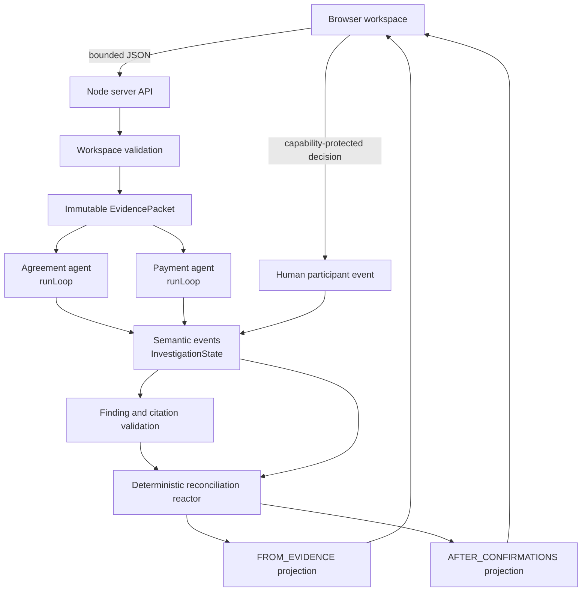

# ABEND Architecture

Status: **IMPLEMENTED AND VERIFIED FOR THE STRUCTURED TEXT-FIRST MVP**

Provider-backed free-form extraction is not verified and is not part of the working product. This document describes the code at the T009 release baseline rather than the earlier proposed architecture.

## Architecture principles

1. Evidence is immutable; interpretations and human decisions are versioned.
2. Investigator output is untrusted until schema, participant, amount, currency, and citation validation succeeds.
3. Financial arithmetic is deterministic, uses integer minor units, and keeps currencies separate.
4. Every included financial term resolves to evidence or an active human decision.
5. Mozaik concurrency and collaboration are runtime behavior, not UI theater.
6. User-entered content is data, never instructions.
7. The browser renders results but does not calculate the authoritative ledger.

## Implemented system

Important implementation files:

- `src/domain/workspace.ts` validates the structured submission and creates evidence sources.
- `src/domain/evidence.ts` creates stable spans, hashes, packets, and citation resolution.
- `src/domain/extractors.ts` parses the bounded structured-record grammar.
- `src/runtime/investigation.ts` owns Mozaik initialization, participants, loops, events, shared state, failures, and review events.
- `src/domain/reconciliation.ts` owns authoritative obligations, payment application, decisions, duplicates, and balances.
- `src/domain/projections.ts` builds evidence-only and after-confirmation explanations.
- `src/server/app.ts` owns HTTP boundaries, sessions, capability checks, expiry, deletion, and static delivery.
- `src/web/client.ts` owns editable form state and safe DOM rendering.

## Mozaik runtime

Abend pins `@mozaik-ai/core` 4.0.6. Installed declarations/source and executed tests verified the runtime surface used by the application.

### Initialization and participants

`createInvestigation` defines and initializes a new typed runtime with an `InvestigationState` subclass of `RuntimeState`. It creates and joins:

- an Agreement agent;
- a Payment agent;
- a deterministic reconciliation participant; and
- a human review participant.

Each participant receives an SDK-generated identity. Runtime initialization is tested to occur exactly once per runtime instance.

### Genuine concurrent loops

The Agreement and Payment agents receive the same serialized immutable evidence packet. The server invokes separate fire-and-forget `runLoop` calls without awaiting either before starting the other.

Native events supply loop IDs and timestamps. Tests use controlled role delays, assert that the measured windows overlap, assert distinct loop IDs, and repeat with both completion orders. No application timestamp or loop ID is fabricated.

### Shared state and semantic events

Validated agent answers become role-specific domain findings and are published with the producing participant ID. Event processors update `InvestigationState`, which stores findings, decisions, reconciliation revisions, agent windows, failures, and sanitized native/domain event records.

The reconciliation participant reacts when either investigator publishes a finding. It can therefore produce an intermediate revision with only one stream and a later revision after both streams arrive. Duplicate events are handled idempotently. This causal shared-state behavior is why the two agents are materially relevant rather than parallel aliases.

### Deterministic inference versus external models

The working product injects `DeterministicInvestigatorRunner`, an `InferenceRunner` implementation that validates Abend's bounded structured-record grammar. It runs inside genuine Mozaik loops but is not an LLM.

`BundledProviderInferenceRunner` and `SafeInferenceRunner` preserve an experimental external-provider boundary. Historical Gemini attempts returned HTTP 500/503 before model output. No provider finding entered reconciliation, so successful external-model extraction remains **BLOCKED / NOT VERIFIED**.

## Evidence and validation

Every source has an evidence type, normalized content, stable source ID, and numbered spans. Citations carry source ID, byte/character bounds, exact excerpt text, excerpt hash, and evidence type.

Before a finding enters shared state, validation checks:

- the source and citation resolve to the current packet;
- excerpt bounds and hashes match immutable evidence;
- participants are declared;
- currencies are supported and declared;
- amount strings have valid precision and convert to positive minor units; and
- statuses cannot be upgraded to privileged certainty by investigator output.

Optional conversation content is preserved and displayed as quoted evidence. It cannot issue instructions, add tools, or create a financial term without a supported structured record.

## Deterministic reconciliation

`reconcileLedger` is the authoritative calculation boundary. It:

1. validates expenses, agreements, payments, decisions, and citations;
2. allocates equal or explicit exact shares;
3. materializes gross obligations;
4. identifies exact duplicate payment fingerprints without hiding them;
5. requires compatible parties, currency, agreement link, and receipt confirmation before payment application;
6. caps overpayment and leaves excess unresolved;
7. calculates signed balances independently per currency; and
8. returns unresolved disputes, payment applications, obligations, and reconciliation reasons.

Amounts are decimal strings at JSON boundaries and `bigint` inside calculation. Binary floating point is not used for authoritative balances. No implicit FX conversion exists.

`buildFinancialViews` derives two views from the same ledger inputs:

- `FROM_EVIDENCE` excludes review-dependent payment effects.
- `AFTER_CONFIRMATIONS` includes only active valid decisions.

Every displayed balance is checked against the effects of its included terms.

## Human review

Review requests require the run's capability token. The human participant can publish:

- `LINK_PAYMENT_TO_AGREEMENT`;
- `CONFIRM_PAYMENT_RECEIPT`;
- `REJECT_PAYMENT_CLAIM`; or
- `REVERSE_DECISION`.

Decisions carry an ID, runtime actor ID, timestamp, and structured target. Reversal appends a decision that deactivates the target; it does not delete evidence or history. Contradictory, duplicate, invented, or unauthorized decisions fail without replacing the existing state.

The runtime actor ID proves which runtime participant emitted the event. It is not authenticated real-world identity.

## Browser and server separation

The framework-free browser:

- builds structured JSON from editable controls;
- submits and displays server responses;
- renders citations and sanitized runtime metadata through text nodes;
- sends capability-protected review/delete requests; and
- contains no balance or obligation calculation.

The Node server:

- limits JSON requests to 32 KiB;
- validates all workspace fields and record counts;
- rate-limits investigation starts per address;
- creates a random run ID and capability token;
- stores runs in a process-local `Map`;
- expires runs after 30 minutes;
- permits capability-protected deletion; and
- serves same-origin assets with CSP and defensive headers.

There is no durable database, account system, cross-device recovery, bank connection, or payment API.

## Trust boundaries

| Boundary | Untrusted input | Enforcement |
| --- | --- | --- |
| Browser → server | JSON fields and quoted evidence | size, type, count, name, currency, amount, share, and status validation |
| Evidence → investigator | source content | data envelope, no tools, bounded deterministic grammar |
| Investigator → shared state | structured answer | schema and citation resolution, participant/currency allowlists |
| Review → ledger | decision kind and target | capability token, allowlisted transition, target existence, contradiction checks |
| Ledger → browser | financial result and trace metadata | deterministic term/balance checks, text-node rendering, redacted event details |

## Failure handling

- Investigator failure or timeout is isolated to that participant.
- Partial validated state remains available and is marked honestly.
- Late answers after a timeout are ignored.
- Provider errors are converted to bounded diagnostics without retaining secrets.
- Invalid citations or impossible records fail before arithmetic.
- API errors return safe codes/messages and preserve the existing run.
- Missing or expired runs return a not-found state and require a new investigation.

## Deployment boundary

Render builds with `npm ci --ignore-scripts && npm run build`, starts the compiled Node server, and checks `/health`. The free service may cold-start or restart. Because sessions exist only in memory, a restart clears them; this is disclosed rather than hidden.

The public deployment is suitable for the bounded hackathon MVP and fictional demonstrations. It is not positioned as durable production financial infrastructure.
