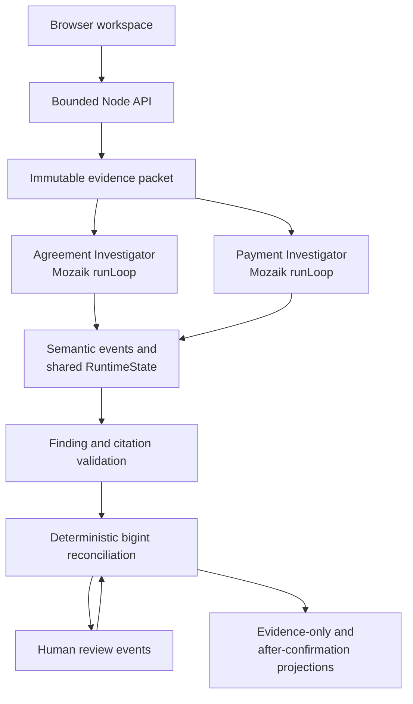

<p align="center">
  
</p>

# Abend

**Settle the numbers. Keep the friendship.**

Abend is an evidence-first shared-expense and repayment reconciliation application. It helps a group work out what its records support, what remains uncertain, and how a reviewed repayment changes the balance.

## The Problem

Shared expenses are often scattered across memories, chat excerpts, expense notes, and transfer records. The arithmetic may be simple, but the underlying facts are not: who agreed to which share, whether a transfer was merely initiated or actually received, and whether the same record was entered twice.

A confident total built on an unsupported assumption can make a disagreement worse. Abend keeps those assumptions visible instead of silently converting them into debt.

## Meet Abend

Abend starts with an empty workspace for structured user-provided records. A user enters participants, one currency, shared expenses, the payer, exact per-person shares, and any repayment claims. An optional bounded conversation excerpt can be preserved as supporting evidence; Abend does not claim to understand arbitrary natural language.

The application creates immutable evidence spans, investigates agreement and payment records concurrently through Mozaik, and validates every material finding against its source. A deterministic ledger then calculates currency-separated balances. Repayments remain outside the balance until a reviewer links and confirms them; the reviewer can instead reject a claim or reverse a prior decision.

## Why Abend Is Different

Abend does not claim to have invented expense splitting. Its distinction is the combination of:

- evidence-cited retrospective reconciliation;
- explicit unresolved and conflicting states;
- conservative treatment of repayment claims;
- human confirmation, rejection, and reversible decisions;
- side-by-side evidence-only and after-confirmation projections; and
- visible, genuine concurrent Mozaik investigation rather than an animated simulation.

## Try Abend

**Live application: [abend.onrender.com](https://abend.onrender.com)**

The free Render service may need a cold start. Once loaded:

1. Enter at least two participants and select a currency.
2. Add an expense, payer, total, and exact shares that sum to the total.
3. Optionally add repayments and a supporting conversation excerpt.
4. Select **Investigate records**.
5. Review the findings, citations, balances, and unresolved payments.

The optional **Load fictional sample** control is clearly labeled. No sample data is silently inserted.

## How It Works

1. Enter participants and expenses.
2. Record each payer and the exact agreed shares.
3. Add repayment claims with sender, recipient, purpose, amount, and claimed status.
4. Optionally provide a bounded supporting excerpt.
5. Start the investigation.
6. Review evidence-backed Agreement and Payment findings.
7. Link and confirm a payment, reject its claim, or reverse a previous decision.
8. Compare the evidence-only and after-confirmation balances.
9. Copy an editable, respectful settlement summary. Abend never sends it.

## Powered by Mozaik

Abend pins [`@mozaik-ai/core` 4.0.6](https://www.npmjs.com/package/@mozaik-ai/core/v/4.0.6). Mozaik is part of the product's execution model, not a decorative wrapper.

- The **Agreement Investigator** validates who participated in each expense, who paid, and the exact documented shares.
- The **Payment Investigator** independently validates repayment parties, amount, currency, purpose, and claimed state.
- Each investigator has a distinct runtime participant identity and starts through its own genuine `runLoop` call.
- Both loops start without awaiting one another. Tests use controlled delays and observed native event windows to prove overlap in either completion order.
- Validated findings are published as semantic events into a shared `RuntimeState`.
- A deterministic reconciliation participant reacts when either finding stream arrives and recomputes when the other changes shared state.
- Human review is also recorded through runtime events and triggers deterministic recalculation.

Both investigators are necessary because an expense agreement and a repayment claim answer different questions. An agreement can establish an obligation without proving that it was repaid. A payment record can show a claimed transfer without establishing its purpose or receipt. Reconciliation becomes meaningful only when it consumes the validated outputs of both.

The core workflow uses a deterministic `InferenceRunner` to parse Abend's bounded structured-record grammar inside real Mozaik loops. It is not described as LLM inference. Earlier controlled external-provider requests failed before returning model output, so external-model extraction remains unavailable.

## Architecture



The browser collects and renders records but contains no financial ledger. Validation, investigation state, decisions, and arithmetic remain server-side.

## A Real Reconciliation Example

The following is a reproducible **TEST SCENARIO**, not customer data:

| Record | Value |
| --- | --- |
| Participants | Mira, Niko, Ola |
| Expense | Cabin, USD 120.00, paid by Mira |
| Exact shares | Mira USD 20.00; Niko USD 40.00; Ola USD 60.00 |
| Repayment claim | Niko sent Mira USD 15.00 for Cabin; status `INITIATED` |

Independent calculation before repayment review:

- Mira paid USD 120.00 but consumed USD 20.00, so Mira is owed USD 100.00.
- Niko owes USD 40.00.
- Ola owes USD 60.00.
- The initiated repayment is not yet applied, so these are also the evidence-only balances.

After a reviewer links the repayment to Cabin and confirms receipt:

- Mira is owed USD 85.00.
- Niko owes USD 25.00.
- Ola still owes USD 60.00.

The signed balances still sum to zero: `+85 - 25 - 60 = 0`.

## Financial Correctness

- Amounts are converted to `bigint` integer minor units before authoritative calculation.
- Exact shares must sum to the expense total; equal-split remainders use a deterministic rule.
- Every amount has an explicit supported currency and exponent. Ledgers never mix currencies or silently apply FX.
- Exact duplicate repayment fingerprints remain visible and are not applied twice.
- A payment needs a compatible agreement link and explicit receipt confirmation before it changes a balance.
- Confirmations and rejections are versioned decisions; reversal appends history instead of deleting it.
- Missing agreements, ambiguous recipients, conflicting claims, and unsupported citations remain unresolved or excluded.

## Technical Stack

| Layer | Implementation |
| --- | --- |
| Language | TypeScript 5.9 |
| Runtime | Node.js 20–24 |
| Agent runtime | `@mozaik-ai/core` 4.0.6 |
| Server | Node `http` server with bounded JSON API and static assets |
| Browser | Framework-free HTML, CSS, and compiled TypeScript |
| Arithmetic | Deterministic domain functions using `bigint` minor units |
| Hosting | Render free web service |
| Tests | Node test runner and a headless Chrome CDP journey |

## Run Locally

Prerequisites: Node.js 20–24, npm, and Chrome or Edge for the browser journey.

```powershell
git clone https://github.com/YakiUdoph/Abend.git
cd Abend
npm.cmd ci --ignore-scripts
npm.cmd run build
npm.cmd run dev
```

Open the printed `ABEND_SERVER_URL`. The core workflow needs no provider key.

On shells where `npm` is directly available, the equivalent `npm` commands work. This repository records `npm.cmd` because it is the verified Windows path.

## Tests and Verification

Run the full local verification:

```powershell
npm.cmd run typecheck
npm.cmd test
npm.cmd run build
npm.cmd run proof
npm.cmd run test:browser
npm.cmd audit
git diff --check
```

`npm.cmd run proof` prints authentic participant IDs, loop IDs, timestamps, overlap, semantic events, and before/after projections from that execution. IDs and timings change on every run and are not fixture constants.

On 2026-10-30, T009 recorded **56 passing automated tests**, a passing clean-clone build/proof/browser journey, zero reported npm audit vulnerabilities, and a public browser journey with 32 ms observed investigator overlap and 27 authentic runtime/domain events. These are dated historical results; rerun the commands above for current evidence. Detailed evidence is preserved in [`PROGRESS.md`](PROGRESS.md).

## Security and Privacy

- Server-side validation bounds participants, records, currencies, names, amounts, shares, statuses, and optional conversation length.
- Request bodies are limited to 32 KiB, and investigation starts are rate-limited per address.
- Review and deletion requests require an unguessable per-run capability token.
- Runs are held only in one server process, expire after 30 minutes, and can be deleted by the capability-holding browser.
- User-supplied content is rendered through DOM text nodes under a same-origin Content Security Policy.
- Production also sends `nosniff`, frame-denial, and no-referrer headers.
- Application code does not log raw conversations.
- Investigators receive no shell, filesystem, secret, bank, payment, or broad-network tools.
- Abend has no bank connection, payment initiation, debt collection, unrestricted inbox scanning, or automatic message sending.

These are MVP controls, not a claim of bank-grade security or a formal security audit. Capability tokens do not provide authenticated user identity.

## Current Limitations

- Input is structured; arbitrary natural-language extraction is unavailable.
- Successful external-model inference has not been verified and is not part of the core workflow.
- There is no OCR or PDF/image extraction.
- There are no persistent accounts, authenticated identities, or cross-device recovery.
- Storage is in-memory rather than durable; Render restarts clear active runs.
- Ratio and receipt-itemized splits are not entered directly, although exact unequal shares are supported.
- Abend cannot access banks, verify bank settlement, or initiate payments.

## Competition

Abend was built for the [JigJoy/NTP Novi Sad AI Hackathon](https://build.jigjoy.ai/) Freestyle track. The [official rules](https://build.jigjoy.ai/rules) require `@mozaik-ai/core` and at least two agents that genuinely run concurrently.

Abend satisfies that technical requirement through separate Agreement and Payment `runLoop` executions whose overlap is asserted from observed runtime events. Their semantic events update shared state and materially change reconciliation. No award, ranking, or completed hackathon submission is claimed.

## Repository Guide

| Path | Purpose |
| --- | --- |
| [`src/domain/`](src/domain/) | Evidence, validation, decisions, projections, and deterministic financial logic |
| [`src/runtime/investigation.ts`](src/runtime/investigation.ts) | Mozaik participants, loops, events, shared state, failures, and review events |
| [`src/server/app.ts`](src/server/app.ts) | Bounded API, session capabilities/lifecycle, security headers, and static delivery |
| [`src/web/client.ts`](src/web/client.ts) | Editable browser journey and safe rendering |
| [`tests/`](tests/) | Arithmetic, provenance, runtime, API, security, and browser verification |
| [`PRD.md`](PRD.md) | Original vision, shipped scope, deferred work, and evidence semantics |
| [`ARCHITECTURE.md`](ARCHITECTURE.md) | Implemented architecture and trust boundaries |
| [`DESIGN.md`](DESIGN.md) | Shipped experience, copy, visual system, and accessibility |
| [`RULES.md`](RULES.md) | Competition facts and non-negotiable safety rules |
| [`TASKS.md`](TASKS.md) | Historical task outcomes and acceptance matrix |
| [`PROGRESS.md`](PROGRESS.md) | Dated execution evidence and release state |
| [`AGENTS.md`](AGENTS.md) | Instructions for future contributors and coding agents |

## Closing

Abend does not try to win an argument for the group. It makes the supported numbers, uncertain claims, and human decisions clear enough for the group to settle the expense without losing the friendship.
